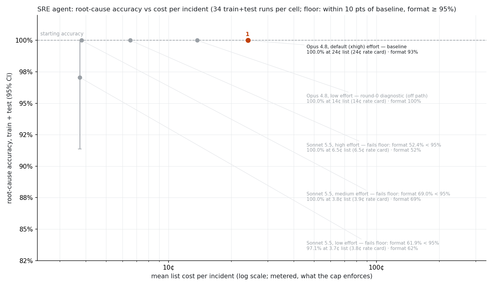

<!-- Copyright 2026 Anthropic PBC -->
<!-- SPDX-License-Identifier: Apache-2.0 -->

# Your SRE agent works. Now make it cheap.

> A follow-on lab to [*Ship Your First Managed Agent*](../README.md), Gagan Bhat's
> Code with Claude workshop (Apache-2.0). That workshop builds the agent. This lab
> measures it, then finds the cheapest model that still names the right commit.

> **Teaching this lab?** Start with the [facilitator guide](facilitator/README.md) (timing,
> talk-tracks, a ready-to-teach checklist) and the [slides](facilitator/slides.html) (open
> in a browser; `A` jumps to troubleshooting).

> **Two meanings of "harness."** The *agent harness* is the loop around the model
> (prompting, tool calls, feeding results back). On Managed Agents, Anthropic runs it, and
> you only configure the agent. The *eval harness* is the measuring setup: cases, tools,
> graders, runner and cost calculation. This lab fingerprints the eval harness and requires
> a human approval whenever it changes, so every result is measured with the same ruler and
> a hillclimb can't raise its score by editing the grader. That's a method from the
> claude-api skill's hillclimb process, not something the API requires.

## The story

Two weeks after the 2am page, the SRE agent is in production. It reads the deploys, lines
them up against p99 latency, reads the diff and names `a3f9c21` every time. It runs on
Opus 4.8 at default effort, at about 24¢ an incident.

Then finance asks the question every production agent gets after "does it work?":
**would a cheaper model catch the same root causes?**

Nobody knows. The workshop has one incident and one test, and the test can't tell a
right answer from a lucky one (checkpoint 2). So this lab builds what's needed to
answer with a measurement instead of an opinion:

- **21 incidents** generated from the original story, in six families, each testing one
  step of the runbook: shifted deploys, rolled-back deploys, innocent commit messages,
  decoy deploys on other services, incidents with no culprit deploy at all, and the
  original page, kept as a regression check.
- **Two code graders**: did the agent name the right culprit, and did it write the
  runbook's one-sentence root-cause line?
- **An eval runner on Managed Agents**: a fresh session per case, a hard budget per
  session, cost read back from the session, and a $50 cap on the whole project.
- **A model × effort walk** down from Opus 4.8, and **one system-prompt hillclimb**.

What happened: every cheaper model found the root cause as reliably as Opus 4.8. What
they got wrong was the *format*. A one-line prompt change fixed that. The result is
Sonnet 5.5 at low effort, 7× cheaper and passing a floor set before any result existed.
Haiku 5.5 at low effort is 57× cheaper, but only scrapes past that floor.

You'll rebuild the two pieces that make that claim trustworthy, a grader and a cost
function, and replay the whole walk on the recorded runs.

## Run it in one command (no API key)

```bash
cd ship-your-first-managed-agent/evals
uv run python checkpoint.py all --solution
```

That replays all five checkpoints with the reference solution on the recorded results in
[`results/`](results/), in about 5 seconds. It needs [uv](https://docs.astral.sh/uv/) and
nothing else: no key, no network after the first `uv` install, no spend.

## What's in this folder

| For | Where |
|---|---|
| **You, in the lab** | `lab/` (your code), `lab_complete/` (the reference), `checkpoint.py`, `viewer.py`, `results/` (the recorded runs every checkpoint replays) |
| **Facilitators** | [`facilitator/`](facilitator/README.md): the guide, and [`slides.html`](facilitator/slides.html), the projected slides with a troubleshooting appendix. `notes-draft.md` is the guide's earlier working draft. |
| **The eval harness** | `run.py`, `graders.py`, `tools.py`, `cases.py`, `generate.py`, `specs.py`, `scenario.py`, `diffs.py`, `pricing.py`, `spend.py`, and `prompts/system.md`. They stay at the top level because their paths are part of the harness fingerprint `run.py` checks. |
| **Analysis scripts** | `walk.py` (floor verdicts), `ledger.py`, `snapshot.py`, `plot_path.py` (the chart), `regrade.py`, `shadow_regrade.py` |
| **Planning** | [`planning/`](planning/plan.md): the implementation plan and session log (`plan.md`), the original brief (`BUILD_BRIEF.md`) and the proof-of-concept plan (`sre-agent-eval-poc-plan.md`). The one-page summary is [`../ONE_PAGER.md`](../ONE_PAGER.md). |
| **The build record** | `hillclimb/` and `pilot/` (full traces), [`COST_LEDGER.md`](COST_LEDGER.md), [`SOURCES.md`](SOURCES.md), `proposals/` (the one grader fix), `tests/` |

Every script runs from this folder with `uv run`. "How the eval is built", at the end,
says what each harness piece does.

## What you build

Two small functions and a one-line swap, the same shape as the original workshop:

| # | You write | File | Lines |
|---|---|---|---|
| 1 | `grade_root_cause(text, answer)` | `lab/grading.py` | about 12 |
| 2 | (nothing new: you run your grader against the old one) | | |
| 3 | `session_cost(model, requests, active_seconds)` | `lab/cost.py` | about 8 |
| 4 | `MODEL, EFFORT = …` | `lab/cell.py` | 1 |
| 5 | (nothing new: your code re-grades and re-prices every recorded run) | | |

Every checkpoint runs with `uv run python checkpoint.py <n>` and has its expected output
below. Stuck? `lab_complete/` has the finished files, and `--solution` runs them.

Setup: Python 3.10+ and uv. The checkpoints need no key. Only the optional live run in
checkpoint 4 does: put `ANTHROPIC_API_KEY` in `ship-your-first-managed-agent/.env`, as in
the original workshop. Use a key created inside a workspace, or the API asks for an
`anthropic-workspace-id` header.

## Checkpoint 1: write the grader

The runbook makes the agent end with one line, `**Root cause:** <sha> — one sentence`, or
a component name such as `db-primary` when no deploy is at fault. The answer space is
closed, so a few lines of code grade it exactly. No LLM judge needed.

Open `lab/grading.py`. The docstring lists four rules, and each fixture below pins one of
them. `find_root_cause_line()` is provided: it returns the text after the label on the
last root-cause line.

```bash
uv run python checkpoint.py 1
```

Expected:

<!-- expected-output: checkpoint 1 -->
```text
Checkpoint 1: grade_root_cause (lab/grading.py)
  ok    the real Opus 4.8 line: blockquote, backticks, em dash
  ok    a full 40-character sha in bold
  ok    a sha followed by a period
  ok    'commit' before the sha
  ok    says 'per-row query', never 'N+1'
  ok    two sentences: format fails, root cause still counts
  ok    mentions the right sha, concludes another
  ok    a sha one character off
  ok    no root-cause line at all
  ok    two root-cause lines: the last one counts
  ok    no culprit: names the component
  ok    no culprit: component in plain words
  ok    no culprit: blames a deploy
  ok    no culprit: names the symptom, not the cause
  ok    no culprit: the wrong component
  ok    no culprit: upstream named casually
16/16 fixtures pass. Next: checkpoint 2.
```

Most fixtures come from `tests/test_graders.py`, written before any eval run. The first
is the real line Opus 4.8 wrote in the smoke test: a blockquote, backticks and an em
dash. A grader that hasn't seen real output usually fails on exactly that. One fixture
came later, "a sha followed by a period". The eval's own grader got it wrong until an
audit of failing rows caught it, after results existed.

## Checkpoint 2: catch the old grader out

The workshop's `e2e.py` passes when the transcript contains "n+1" and `a3f9c21`
anywhere (`e2e.py:89-90`). It's the lab's only test, and it passed. Read those two lines,
then predict: on 289 real replies from cheaper models, how many does it get wrong, and
which way?

```bash
uv run python checkpoint.py 2
```

Expected:

<!-- expected-output: checkpoint 2 -->
```text
Checkpoint 2: the e2e.py grader, next to yours
e2e.py passes a reply when "n+1" and the sha appear anywhere in it (e2e.py:89-90).

Both checks on all 289 recorded replies to deploy cases (7 cells in results/;
e2e.py's check is applied with each case's own sha):
  e2e.py fails a correct answer     40
  e2e.py passes a wrong answer       0
  both pass                        248
  both fail                          1
For example ladder/v1, dc-cart rep 1, right but no "N+1":
  **Root cause:** `0c1986c` — `price_cart` now runs one `SELECT ... WHERE sku_id = ?` per cart line instead of a single batched `IN` query, so each request makes N sequential DB round trips and p99 rose about 50x.

In theory it can also pass a wrong answer. No recorded agent did; these are written fixtures:
  reply                                        e2e.py  yours  right?
  correct, says "per-row query", not "N+1"     fail    PASS   yes
  recaps every deploy, concludes 9f1e2d4       PASS    fail   no
```

On real data the old check fails 40 correct answers and passes no wrong one. Its real
flaw is strictness: all 40 name the right sha but describe the bug in other words, such
as a per-row query, without ever writing "N+1". That never showed while one model ran
one test. It matters as soon as you compare models: a cheaper model that phrases things
differently looks worse than it is, and the cost decision gets made on a broken ruler.

The lenient failure is real in principle. An agent that recaps every deploy and floats
"N+1" as one hypothesis passes even when it blames the wrong commit. But only a written
fixture shows it; no recorded agent did it. The original lab stays as it shipped. The
eval uses your grader instead.

## Checkpoint 3: price a session

Managed Agents reports each model request's tokens on the event stream
(`span.model_request_end`). Price them from the rate card, add runtime at $0.08 per
session-hour, and you have the cost of one incident.

Open `lab/cost.py`. The rates are filled in. Watch for one thing: Haiku 5.5's long-prompt
tier is decided **per request**, so summing a session's tokens first gets it wrong.

```bash
uv run python checkpoint.py 3
```

Expected:

<!-- expected-output: checkpoint 3 -->
```text
Checkpoint 3: session_cost (lab/cost.py)
Two recorded canary sessions on case reg-500s (results/pilot/):

  session            requests  input  output  cache read  cache write  your cost  list_cost
  Opus 4.8, xhigh          10     20   3,281     106,704       17,845    $0.2481      $0.25
  Haiku 5.5, low            8     18   2,838      79,474       15,849    $0.0047      $0.02

Your session_cost matches pricing.py on 407/407 recorded sessions.
Haiku's list_cost reads 4.3× its rate card. The Console bill followed the rate card
(SOURCES.md, Haiku 5.5 billing check), so the path chart's x axis is the rate card.
```

Each session also reports its own `list_cost`. For Opus and Sonnet it agrees with your
number to the cent. For Haiku it doesn't, and the Console bill sided with the rate card.
So the chart's x axis uses your number, while the $50 spend cap stays on `list_cost`, the
more cautious of the two.

## Checkpoint 4: swap the model

Model and effort are the cost dials. Change the one line in `lab/cell.py` to Haiku 5.5 at
low effort:

```python
MODEL, EFFORT = "claude-haiku-5-5", "low"  # checkpoint 4: swap this line
```

```bash
uv run python checkpoint.py 4
```

Expected:

<!-- expected-output: checkpoint 4 -->
```text
Checkpoint 4: the model swap (lab/cell.py)
  cell: claude-haiku-5-5, effort low
  recorded run: results/pilot/haiku-5-5-low/ (case reg-500s, one session)
    the session echoed: model claude-haiku-5-5, effort low
    root cause 1 (your grader), format 1
    $0.0047 at the rate card (your session_cost), $0.02 list_cost, 22 s, 9 tool calls, 2,838 output tokens
    root-cause line: **Root cause:** `a3f9c21` — the refactor turned the batched order-items query into one query per open order, multiplying DB round-trips per checkout request until the 50-connection checkout pool was exhausted, causing PoolTimeout 500s.
Run it yourself (one session, about 2¢; needs ANTHROPIC_API_KEY in ../.env):
  uv run python checkpoint.py 4 --live
```

The output shows the recorded canary for your cell, graded by your grader and priced by
your `session_cost`. With a key, `--live` runs the same case for real: one session,
about 2¢ list, through the eval runner (`run.py`), on the workshop's original system
prompt. Its rows land in `lab_runs/` (gitignored), and `spend.py` counts them. Add
`--dry-run` to see the scope and the spend projection without sending anything. The run
stops with exit 2 if the eval harness changed since its last approval (see "Two
meanings of harness" above).

The session's echoed effort is worth a look. Opus 4.8 with no effort set reports
`xhigh` on Managed Agents, not the `high` the docs table gives. That's why the baseline
is read from the echo, never assumed.

## Checkpoint 5: read the path

Your grader and your cost function now re-score every recorded cell of the walk and the
hillclimb:

```bash
uv run python checkpoint.py 5
```

Expected:

<!-- expected-output: checkpoint 5 -->
```text
Checkpoint 5: the cost-reduction path (results/, graded and priced by your code)
Floor, pre-registered: root cause on train+test ≥ 90.0% (baseline − 10 points), reg-verbatim right on every rep, format ≥ 95%.

  #  cell            model, effort, prompt        rows root cause  format verbatim ¢/incident  floor
  1  ladder/baseline Opus 4.8, xhigh, shipped       42     100.0%   92.9%      2/2      24.02  reference
     ladder/v1       Sonnet 5.5, low, shipped       42     100.0%   61.9%      2/2       3.75  fail: format
     ladder/v2       Opus 4.8, low, shipped         21     100.0%  100.0%      1/1      13.65  pass (off path)
     ladder/v3       Sonnet 5.5, medium, shipped    42     100.0%   69.0%      2/2       3.89  fail: format
     ladder/v4       Sonnet 5.5, high, shipped      42     100.0%   52.4%      2/2       6.52  fail: format
  2  climb/v1        Sonnet 5.5, low, climbed       84     100.0%   97.6%      4/4       3.41  pass
  3  ladder/v5       Haiku 5.5, low, climbed        84      92.6%   95.2%      4/4       0.42  pass

Your grades match the recorded ones on 357/357 rows; your costs match the recorded rate card on 357/357.
Adopted path (#): 24.02¢ → 3.41¢ → 0.42¢ per incident at the rate card (7.0× and 57.4× cheaper than Opus 4.8).
Chart: results/path.png. The walk ends at Haiku 5.5 low, a narrow pass; climbed Sonnet 5.5 low
passes with margin and is the deployment recommendation (COST_LEDGER.md).
```



**Reading the chart.**

- **Axes.** x is the mean cost per incident at the rate card, on a log scale. y is
  root-cause accuracy on the train and test cases, with 95% confidence intervals.
- **The path.** The filled, numbered points, linked by dashed arrows, are the cells
  that were adopted, in order. Hollow points were visited but not adopted; the list
  under the chart says which cell each is and why. The dashed line is the floor.
- **The walk** goes in this order:
  - It starts at the baseline (Opus 4.8, default effort).
  - It enters at Sonnet 5.5 low.
  - Sonnet fails, on format only, so the walk steps right twice (medium, high). More
    effort makes format *worse*: 61.9% → 69.0% → 52.4%.
  - Effort can't fix it, so one system-prompt change does. Climb round 1 says the
    root-cause line is one sentence, written once, last. Sonnet 5.5 low then passes at
    3.41¢.
  - From that pass, the walk steps down to Haiku 5.5 low with the same prompt, which
    passes narrowly.
- **The hollow point at 13.65¢** (v2) is a diagnostic, Opus 4.8 at low effort. It was run only
  to check that the effort dial is alive (output tokens fell 4,371 → 1,735 per session),
  and it was kept off the path by design.

Three things to notice:

- **Accuracy never moved; format did.** Every cell scores 100% root cause except Haiku.
  The floor is what separates the cells, so read it before the costs. One flaw of the
  floor: Opus 4.8 itself scores only 92.9% on format, below the ≥ 95% bar it sets for
  everyone else.
- **Haiku's pass is narrow.** Format clears 95% by one row out of 84. All five of its
  misses are on held-out test cases, and four of the five are a correct answer with the
  bold `**Root cause:**` label dropped. That's why the recommendation is climbed Sonnet
  5.5 low (32/32 on held-out test) and not the cheapest cell.
- **The confirmation rule decided a verdict.** Haiku failed at 2 reps and passed at 4.
  Re-running a result that's within noise of the floor was pre-registered, so it wasn't
  chosen after the fact.

Running the walk yourself costs real money: the Opus 4.8 baseline alone is about $10 for
42 sessions. To regenerate the chart from the recorded runs:
`uv run --with matplotlib==3.10.0 python plot_path.py`.

## Optional: the path in a browser

Checkpoint 5's table and chart, plus every reply behind them, in a small Streamlit page
graded and priced by your own `lab/` code:

```bash
uv run --with streamlit==1.65.0 streamlit run viewer.py
```

It's read-only: it reads `results/` and never calls the API. Until checkpoints 1 and 3
are done it says "not done yet". The sidebar toggle switches to `lab_complete/`, the same
as `--solution`. Edit and save your `lab/` files, click **Rerun** (top right), and the
page re-grades. Three things to
look at:

- **Path tab: your table.** The same numbers checkpoint 5 prints, with the floor verdict
  for each cell, and the path drawn from your numbers: the adopted cells numbered and
  linked, the others hollow (hover for the cell), the floor dashed. The recorded
  `path.png`, with confidence intervals, is in an expander underneath.
- **Cases tab: the 40 rows from checkpoint 2.** Pick a cell, then "e2e.py fails a correct
  answer". Most of the 40 are in `ladder/v5` (21) and `climb/v1` (13). Pick a row to see
  the answer key, the root-cause line your grader read, and the full reply.
- **Cases tab: what one session costs.** Each model request priced by your
  `session_cost`, plus runtime.

Streamlit isn't in `pyproject.toml` on purpose. Adding it would change `uv.lock`, and with
it the harness sha that `run.py` checks. Not built yet: running eval cases through the
workshop dashboard's own chat panel. That's in
[`planning/plan.md`](planning/plan.md), "What would come next".

## Stretch: one hillclimb round

Run a round of `/claude-api hillclimb` on the system prompt in `prompts/system.md`, with
Haiku 5.5 low as the target. The recorded Haiku misses
(`hillclimb/ladder/v5/change.md`) point at the next fix: the dropped bold label. Rules
that held for the recorded round:

- **What the analyzer sees.** It gets the train transcripts only (shifted, rolled_back,
  innocent_message), never the test or val ones.
- **Overfitting.** A patch that names a sha, "checkout", or a specific time is overfitting
  and gets reverted.
- **Scope.** Only the system prompt is in scope. The runbook, tools, graders and cases
  are off limits.
- **Regression.** The val score must not drop below the climb baseline's.

The recorded round is in [`hillclimb/climb/`](hillclimb/climb/narrative.md).

## How the eval is built

| Piece | File | What it does |
|---|---|---|
| Cases | `specs.py`, `generate.py` | 21 incidents from one parameterized generator: log, metrics, deploys and diffs from the same simulated requests, so they agree. `cases/` is regenerated deterministically, not committed. |
| Splits | `hillclimb/ladder/_state.json` | Train: shifted, rolled_back, innocent_message (9). Test: whole held-out families, decoy and no_culprit (8). Val: the 4 regression cases, never used as evidence. |
| Tools | `tools.py` | The agent's three custom tools, served from each case's fixtures only. The answer key can't be reached (`tests/test_isolation.py`). |
| Graders | `graders.py` | `root_cause` and `format`, pure functions. Your `lab/grading.py` is the first. |
| Runner | `run.py` | A Managed Agents session per (case, rep), stream-first, with a hard budget, a 600 s ceiling, cost from `sessions.retrieve()`, and the eval-harness gate. |
| Cost | `pricing.py`, `spend.py`, `ledger.py` | The rate card, cumulative spend against the cap, and [`COST_LEDGER.md`](COST_LEDGER.md). |
| The walk | `walk.py` | Scores each cell against the pre-registered floor. |
| Recorded runs | `results/`, `hillclimb/`, `pilot/` | `results/` is the lab's snapshot (`snapshot.py`). The full traces are in `hillclimb/` and `pilot/`. |
| Viewer | `viewer.py` | A read-only Streamlit page over `results/`, graded and priced by your `lab/`. Tested by `tests/test_viewer.py` (`uv run --with streamlit==1.65.0 pytest tests/test_viewer.py`; plain `uv run pytest` skips it). |

`uv run pytest` runs the whole suite offline (graders, generator, isolation, runner
wiring with a fake backend, shortcut agents, and this lab). Summaries of what happened:
[`hillclimb/ladder/narrative.md`](hillclimb/ladder/narrative.md) and
[`hillclimb/climb/narrative.md`](hillclimb/climb/narrative.md). Every model ID, field and
claim is mapped to its source in [`SOURCES.md`](SOURCES.md). Teaching it:
[`facilitator/`](facilitator/README.md). The full build record is in
[`planning/plan.md`](planning/plan.md).

## Credits and license

Built on Gagan Bhat's original workshop, *Ship Your First Managed Agent*, in
`anthropics/cwc-workshops` (Apache-2.0). The original lab is unchanged apart from Change 1
(`config.py`, one place for the model, effort, prompt and tools) and still ships its
original system prompt. The method follows the `claude-api` skill's `build-eval` and
`hillclimb` commands and the claude.dev post *Automating eval design and hillclimbing
with Claude*.

Licensed under the Apache License 2.0, like the repository (see [`LICENSE`](../../LICENSE)).
The original workshop README's footer says "MIT". The repository license and the source
headers say Apache-2.0, and that's what applies here.
